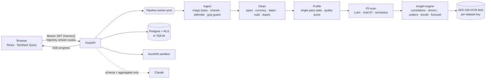

# Secure Analytics Pro

**Upload a messy CSV, JSON, Excel or Parquet file and get trustworthy, explained insights back in about a second, with personal data masked and everything encrypted at rest.**

Secure Analytics Pro is a full-stack app. A FastAPI + Polars + DuckDB engine cleans, profiles and analyses data. A React frontend shows the live pipeline, the insights, the charts, a SQL sandbox and an optional AI analyst. Security is part of the architecture, not something added at the end.



## What it does

| Area | Details |
| --- | --- |
| **Ingestion** | CSV/TSV/any delimiter, JSON (including `{"data": [...]}` API shapes and nested objects, which are flattened), NDJSON, Excel (largest sheet), Parquet, gzip. The format is decided from the bytes, never the extension. Encodings are detected and transcoded to UTF-8. |
| **Auto-cleaning** | `$1,200.50`, `1.234,50` (European), `(300)` accounting negatives, `10%`, `yes/Y/TRUE`, several date formats in one column, `N/A`/`-`/`null` placeholders, case and spacing variants (`west`, ` WEST `), duplicate rows and blank rows/columns are all handled. Leading-zero IDs and card or phone numbers stay text. Every repair is logged. |
| **Profiling** | All per-column statistics come from a single multi-threaded Polars scan. You get Freedman–Diaconis histograms, top values, entropy, timelines, and a source-quality score (completeness, validity, uniqueness, consistency). |
| **Insights** (ranked by effect size × support) | Pearson + Spearman correlations (and near-duplicate columns) · categorical drivers via η² · Pareto concentration · log-aware IQR outliers · robust Mahalanobis multivariate anomalies · Mann–Kendall trend significance · rolling-median anomaly periods · seasonality (ACF) · Holt forecasts with widening 95% intervals · partial last-period detection |
| **Privacy** | 13 PII types (card numbers with Luhn, IBAN with mod-97, SSN, email, phone, IP, names, addresses, DOB…). Critical columns are redacted and high-risk ones masked **by default**. Owners can switch any column to visible, mask, HMAC pseudonym (joinable) or redact. The policy is enforced server-side for previews, SQL, AI and exports. |
| **Explore** | DuckDB SQL over a zero-copy Arrow view of the privacy-filtered table, plus an AI analyst (Claude). The AI writes SQL, the sandbox runs it, and you get an answer and a chart. |
| **Export** | Cleaned CSV/Parquet/JSON with the privacy policy applied and CSV formula injection neutralised. |

## Security model

| Control | Implementation |
| --- | --- |
| Data at rest | Envelope encryption: each dataset gets its own AES-256-GCM key, wrapped by a master KEK. Chunks are authenticated with their index and a final-chunk flag, so truncation or reordering is detected. **Raw uploads are never written to disk.** |
| Deletion | Crypto-shredding: the wrapped key is deleted and the ciphertext overwritten. |
| Passwords | Argon2id (64 MiB, t=3). Constant-time dummy verification hides which accounts exist. Progressive lockout after 5 failures. |
| Sessions | 15-minute EdDSA (Ed25519) access JWTs held only in memory. Rotating opaque refresh tokens are stored as SHA-256 hashes in an httpOnly, `SameSite=Strict` cookie scoped to `/api/auth`. **Replaying a rotated token revokes the session.** Users can see and revoke their sessions. |
| Tenant isolation | Every query is owner-scoped. On PostgreSQL, `FORCE ROW LEVEL SECURITY` policies key on a per-transaction `app.user_id`, and the app connects as a non-superuser, `NOBYPASSRLS` role. |
| Audit | A per-user SHA-256 hash chain covers logins, uploads, queries, AI questions, exports, privacy changes and deletions. `/api/audit/verify` recomputes the chain and pinpoints the first tampered event. |
| SQL sandbox | DuckDB's own parser allows exactly one `SELECT`. File, network and extension access is disabled, the configuration is locked, the only table is `data`, and row, memory, thread and time limits apply (interrupt on timeout). |
| Hostile files | Magic-byte detection, rejection of binaries, legacy `.xls` and non-workbook ZIPs, a decompression-bomb ceiling, and an upload size cap enforced while streaming. |
| HTTP | Strict CSP, `X-Frame-Options: DENY`, `nosniff`, COOP/CORP, HSTS in prod, `no-store` on API responses, token-bucket rate limits per user/IP, CSRF header on cookie-authenticated endpoints, explicit CORS allow-list. |
| AI | Claude receives the schema, aggregate statistics and up to 50 rows of query results computed on the **privacy-filtered** frame. It never sees raw rows. Server-side refusal fallbacks are enabled. |

## Quick start (development)

Prerequisites: Node 20+, [uv](https://docs.astral.sh/uv/) (it installs Python 3.13 for you).

```bash
npm run setup
```

```bash
npm run dev
```

Open http://localhost:5173, create an account and click **Try messy sample**. In dev, SQLite is used and the master key and JWT signing keys are generated once under `Backend/data/keys/` (git-ignored). The Vite dev server proxies `/api` to the backend, so dev runs same-origin, exactly like production.

To enable the AI analyst, set `ANTHROPIC_API_KEY` in your shell or in `Backend/.env` before starting the API.

## Production (Docker)

```bash
cp .env.example .env
```

```bash
cd Backend && uv run python scripts/gen_secrets.py
```

Paste the generated values into `.env`, then:

```bash
docker compose up --build
```

A single container serves the API and the built frontend on port 8000, alongside PostgreSQL with RLS enforced through a least-privilege role (`deploy/postgres-init.sh`). Put it behind TLS and set `SAP_COOKIE_SECURE=true`.

## Tests

```bash
npm test
```

The backend suite (pytest) covers the cleaning engine (currency, European decimals, mixed dates, encodings), PII detection and masking, envelope-encryption tamper detection, trend statistics, and the full API: auth, lockout, refresh-token reuse detection, tenant isolation, the SQL sandbox deny-list, JSON/NDJSON/gzip ingestion, binary rejection, CSV formula-injection neutralisation, audit tampering detection and crypto-shredding. CI runs it against SQLite **and** PostgreSQL (where the RLS test also runs), and builds the frontend.

## API

| Method | Path | Purpose |
| --- | --- | --- |
| `POST` | `/api/auth/register` · `/login` · `/refresh` · `/logout` | Session lifecycle |
| `GET/DELETE` | `/api/auth/sessions[/{id}]` | List or revoke sessions |
| `POST` | `/api/datasets` | Upload (202, processed in the background) |
| `GET` | `/api/datasets/{id}/events` | Server-Sent Events progress stream |
| `GET` | `/api/datasets/{id}/report` | Full analysis |
| `GET` | `/api/datasets/{id}/rows` | Paged, sortable, searchable rows (policy applied) |
| `POST` | `/api/datasets/{id}/query` | Sandboxed SQL |
| `POST` | `/api/datasets/{id}/ask` · `/narrative` | AI analyst |
| `PUT` | `/api/datasets/{id}/privacy` | Per-column privacy policy |
| `GET` | `/api/datasets/{id}/export?format=csv\|parquet\|json` | Safe export |
| `DELETE` | `/api/datasets/{id}` | Crypto-shred |
| `GET` | `/api/audit` · `/api/audit/verify` | Audit trail and chain verification |

Interactive docs are at `/api/docs` outside production.

## Project layout

```
Backend/
  app/core/       config, envelope crypto, Argon2/JWT, rate limiting, security headers
  app/db/         SQLAlchemy models, sessions, PostgreSQL RLS policies
  app/engine/     ingest → clean → profile → pii → insights/timeseries, DuckDB sandbox, pipeline
  app/services/   encrypted storage + LRU frame cache, job runner + SSE hub, audit chain, Claude
  app/api/        auth, datasets, system/audit routes
  tests/          engine + end-to-end API tests
  scripts/        sample-data generator, secret generator
Frontend/
  src/pages/      Landing, Auth, Workspace, Security Center, dataset/* tabs
  src/components/ design system, charts (Recharts), upload pipeline, insight cards
  src/lib/        API client (in-memory tokens, refresh, SSE over fetch), types, formatting
samples/          messy_sales.csv (synthetic: fake names and Luhn-valid test card numbers)
```

## What changed from v1

v1 was a single `/upload` endpoint that returned the row count, column names and the first five rows, with a basic React form. Its content-type check was client-controlled, CORS was `*` with credentials, there was no size limit, error messages leaked internals, the API URL was hard-coded, and GitHub Pages routing broke because of the base path. v2 replaces all of it. Because the app now needs its backend, it ships as a single container rather than a static GitHub Pages site.
