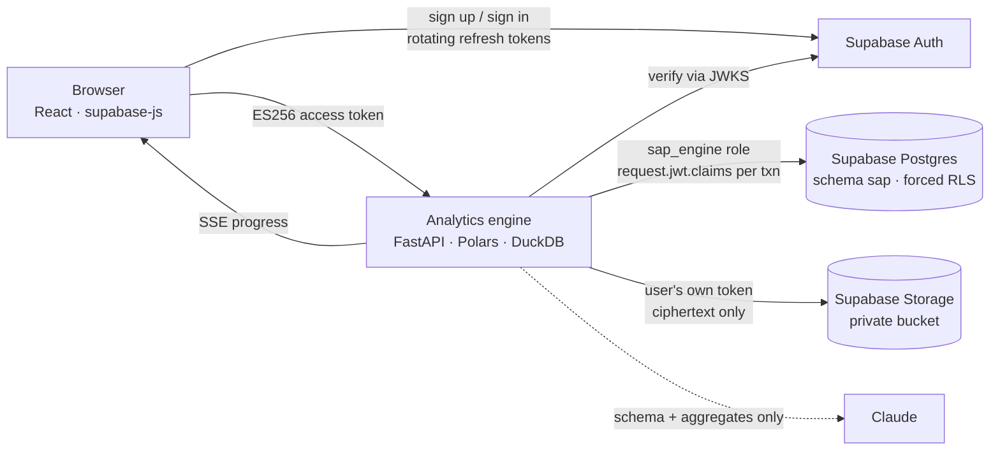

# Secure Analytics Pro

**Upload a messy CSV, JSON, Excel or Parquet file and get trustworthy, explained insights back in seconds, with personal data masked and everything encrypted at rest.**

Secure Analytics Pro is a full-stack app built on **Supabase**:

- **Supabase:** Auth for identity, Postgres with Row Level Security for data, and Storage for encrypted files.
- **Analytics engine:** a FastAPI + Polars + DuckDB service that cleans, profiles and analyses data.
- **Frontend:** React, with a live pipeline view, insights, charts, a SQL sandbox and an optional AI analyst.



## What it does

| Area | Details |
| --- | --- |
| **Ingestion** | CSV/TSV/any delimiter, JSON (including `{"data": [...]}` API shapes and nested objects, which are flattened), NDJSON, Excel (largest sheet), Parquet, gzip. The format is decided from the bytes, never the extension. Encodings are detected and transcoded to UTF-8. |
| **Auto-cleaning** | `$1,200.50`, `1.234,50` (European), `(300)` accounting negatives, `10%`, `yes/Y/TRUE`, several date formats in one column, `N/A`/`-`/`null` placeholders, case and spacing variants (`west`, ` WEST `), duplicate rows and blank rows/columns are all handled. Leading-zero IDs and card or phone numbers stay text. Every repair is logged. |
| **Profiling** | All per-column statistics come from a single multi-threaded Polars scan. You get histograms, top values, entropy, timelines, and a source-quality score (completeness, validity, uniqueness, consistency). |
| **Insights** (ranked by effect size × support) | Pearson + Spearman correlations · categorical drivers via η² · Pareto concentration · log-aware IQR outliers · robust Mahalanobis anomalies · Mann–Kendall trends · anomaly periods · seasonality · Holt forecasts with 95% intervals · partial-period detection |
| **Privacy** | 13 PII types (Luhn-checked card numbers, mod-97 IBANs, SSN, email, phone, IP, names, addresses, DOB…). Critical columns are redacted and high-risk ones masked **by default**. Owners can switch a column to visible, mask, HMAC pseudonym or redact. The policy applies to previews, SQL, AI, exports **and the report's own statistics**. |
| **Explore** | DuckDB SQL over a zero-copy Arrow view of the privacy-filtered table, plus an AI analyst (Claude) that writes the SQL, runs it in the sandbox and answers with a chart. |

## The Supabase backend

Everything lives in `supabase/migrations/` and is designed for this app:

| Piece | Design |
| --- | --- |
| **Identity** | Supabase Auth handles email/password sign-up with email confirmation, password reset, and refresh tokens that rotate on every use with reuse detection. The browser talks to Auth directly with the publishable key. |
| **Token verification** | The engine verifies every ES256 access token against the project's public **JWKS**: algorithm, issuer, `aud=authenticated`, expiry, `session_id`, and no anonymous or service-role tokens. It holds no JWT secret. |
| **Private schema** | Application tables live in schema `sap`, which is **not exposed** through Supabase's Data API. Browsers can't query them at all. |
| **Least-privilege engine role** | The engine connects as `sap_engine`: no superuser, no BYPASSRLS, no inherited roles, and table grants only. Each transaction carries the caller's verified claims (`request.jwt.claims`), the same mechanism Supabase's own API uses. |
| **Row Level Security** | RLS is forced on every table, and every policy keys on `sap.uid()`. A query with a forgotten filter, or one forging another owner's id, is rejected by Postgres itself. |
| **Instant revocation** | `sap.authorize()` scopes the transaction **and** checks `auth.sessions` in one round trip. Revoke a device and its unexpired access token fails on its next request, not when it expires. |
| **Session management** | `sap.list_sessions()` and `sap.revoke_session()` are SECURITY DEFINER functions that expose only the caller's own rows in `auth.sessions`. |
| **Audit trail** | `sap.audit_events` is a per-user SHA-256 hash chain and is **append-only in the database**: the engine has no UPDATE/DELETE grant, and a trigger rejects changes even from admin roles. |
| **Encrypted storage** | Each dataset gets its own AES-256-GCM key, wrapped by a master key the engine holds. Only ciphertext is uploaded to the private `datasets` bucket, under `<user id>/<dataset id>.sap`. Storage RLS limits each user to their own folder, and the engine uploads **with the user's own token**, so it never needs the service-role key. |
| **Crypto-shredding** | Deleting a dataset removes its ciphertext from Storage and its wrapped key from Postgres. |

Check a live project's isolation guarantees at any time:

```bash
cd Backend && uv run python scripts/check_supabase.py
```

## Running it

Prerequisites: Node 20+, [uv](https://docs.astral.sh/uv/) (it installs Python 3.13), and a Supabase project.

1. **Database:** apply `supabase/migrations/*.sql` in order (SQL editor or `supabase db push`). Then give the engine role a password in the SQL editor: `alter role sap_engine with password '…';`. `uv run python scripts/gen_secrets.py` prints a strong one.
2. **Auth settings** (Dashboard → Authentication):
   - **URL Configuration:** set the Site URL to your app's origin (`http://localhost:5173` in development) and add `/app` and `/reset-password` under it to the redirect allow-list.
   - **Passwords:** require a minimum length of 10 with mixed character classes, and enable *leaked password protection*.
   - **SMTP:** configure custom SMTP before inviting real users. The built-in mailer only sends to your team's addresses.
3. **Engine:** copy `Backend/.env.example` to `Backend/.env` and fill in the pooler URL for `sap_engine`, the project URL and the publishable key.
4. **Frontend:** copy `Frontend/.env.example` to `Frontend/.env.local`.
5. Install everything:

```bash
npm run setup
```

6. Start both servers:

```bash
npm run dev
```

Open http://localhost:5173. To enable the AI analyst, set `ANTHROPIC_API_KEY` for the engine.

**Latency:** deploy the engine in the **same region as the Supabase project**. Each API call makes a couple of database round trips, which take about 1 ms in-region but over 100 ms across continents.

### Vercel (production)

`vercel.json` deploys the app as one Vercel project with two [Services](https://vercel.com/docs/services): the Vite frontend (`web`) and the FastAPI engine (`api`, receiving `/api/*`). Set the function region to **lhr1** (London), next to the Supabase project, and add these environment variables:

| Variable | Value |
| --- | --- |
| `SAP_ENV` | `prod` |
| `SAP_DATABASE_URL` | session-pooler URL for `sap_engine` (sensitive) |
| `SAP_MASTER_KEY` | 32-byte base64 key-encryption key (sensitive, and back it up: losing it makes every dataset unreadable) |
| `SAP_SUPABASE_URL`, `SAP_SUPABASE_PUBLISHABLE_KEY` | project URL and publishable key |
| `VITE_SUPABASE_URL`, `VITE_SUPABASE_PUBLISHABLE_KEY` | the same two values, for the frontend build |
| `ANTHROPIC_API_KEY` | optional, enables the AI analyst |

The serverless design shapes three things:

- **Uploads bypass the 4.5 MB function request limit:** the browser encrypts each file with a one-time AES-256-GCM key and uploads the ciphertext straight to the user's private Storage folder. The engine decrypts it in memory, then deletes the encrypted upload.
- **Processing runs inside the request that streams its progress,** because serverless functions don't keep running after a response ends.
- **Uploads are capped at 45 MB** by the Supabase free plan's 50 MB object limit, and **exports at about 4.5 MB** by Vercel's response size limit.

### Docker

```bash
cp .env.example .env
```

```bash
docker compose up --build
```

A single container serves the engine and the built frontend on port 8000. Supabase provides the database, auth and storage. Put it behind TLS.

## Tests

```bash
npm test
```

The offline suite (pytest) runs without network access. It uses SQLite, a local blob store, and locally minted ES256 tokens shaped exactly like Supabase's. It covers:

- **Engine:** cleaning (currency, European decimals, mixed dates, encodings), PII detection and masking, envelope-encryption tamper detection, and trend statistics.
- **Tokens:** rejection of forged, expired, wrong-audience, wrong-issuer, anonymous and service-role tokens.
- **API:** tenant isolation, report scrubbing, the SQL sandbox deny-list, JSON/NDJSON/gzip ingestion, binary rejection, CSV formula-injection neutralisation, audit tampering detection and crypto-shredding.

CI runs it and builds the frontend. `scripts/check_supabase.py` verifies the RLS, grants and append-only rules against the real project.

## API

| Method | Path | Purpose |
| --- | --- | --- |
| `GET` | `/api/auth/me` | Verified identity |
| `GET/DELETE` | `/api/auth/sessions[/{id}]` | List or revoke Supabase sessions |
| `POST` | `/api/datasets` | Upload (202, processed in the background) |
| `GET` | `/api/datasets/{id}/events` | Server-Sent Events progress stream |
| `GET` | `/api/datasets/{id}/report` | Full analysis (privacy-scrubbed) |
| `GET` | `/api/datasets/{id}/rows` | Paged, sortable, searchable rows (policy applied) |
| `POST` | `/api/datasets/{id}/query` | Sandboxed SQL |
| `POST` | `/api/datasets/{id}/ask` · `/narrative` | AI analyst |
| `PUT` | `/api/datasets/{id}/privacy` | Per-column privacy policy |
| `GET` | `/api/datasets/{id}/export?format=csv\|parquet\|json` | Safe export |
| `DELETE` | `/api/datasets/{id}` | Crypto-shred |
| `GET` | `/api/audit` · `/api/audit/verify` | Audit trail and chain verification |

Sign-up, sign-in, sign-out and password reset go straight from the browser to Supabase Auth.

## Project layout

```
supabase/migrations/  schema sap, sap_engine role, RLS policies, auth/session functions, storage bucket + policies
Backend/
  app/core/       config, envelope crypto, Supabase JWT verification, rate limiting, security headers
  app/db/         ORM mappings, claim-scoped sessions (request.jwt.claims)
  app/engine/     ingest → clean → profile → pii → insights/timeseries, DuckDB sandbox, pipeline
  app/services/   Supabase Storage + LRU frame cache, job runner + SSE hub, audit chain, Claude
  app/api/        sessions, datasets, system/audit routes
  scripts/        sample generator, secret generator, live Supabase isolation check
Frontend/
  src/lib/        supabase-js client, API client, types, formatting
  src/pages/      Landing, Auth (sign in/up, reset), Workspace, Security Center, dataset/* tabs
samples/          messy_sales.csv (synthetic: fake names and Luhn-valid test card numbers)
```

## What changed from v1

v1 used Supabase only to check a login token in front of a single `/upload` endpoint that returned row counts and a 5-row preview. It had no tables, RLS policies or storage. v2 adds a real Supabase backend:

- a private schema with forced RLS
- a least-privilege engine role
- session-aware revocation
- an append-only audit chain
- an encrypted Storage bucket
- the full analytics engine and frontend described above
